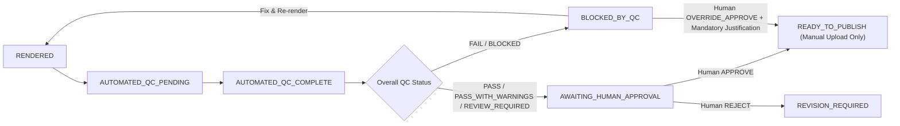

# Human Approval & Override Workflow

**Studio:** Pyapiras Games — AI Marketing & Creative Content Production Studio  
**Audit Log:** `data/qc_approval_audit.jsonl`  
**Job State Store:** `data/qc_jobs/`

---

## 1. Zero Auto-Publishing Policy

**Automated QC never publishes, schedules, or uploads any video to Instagram, Facebook, YouTube, or any external platform.**

Every production artifact must pass through an explicit human review gate before it is eligible for manual upload. Every audit record written by `scripts/qc_orchestrator.py approve` hard-codes:
```json
"auto_published": false
```

---

## 2. Lifecycle State Machine



### State Definitions
- **`RENDERED`:** Master or multi-platform export pack completed by Phase 3 / Phase 4.
- **`AUTOMATED_QC_PENDING`:** Job registered for Phase 5 QC inspection.
- **`AUTOMATED_QC_COMPLETE`:** All technical, audio, visual/OCR, content, platform, and licensing checks finished; reports written (`qc_report.json`, `issue_timeline.json`, `qc_summary.md`).
- **`BLOCKED_BY_QC`:** Overall status is `FAIL` or `BLOCKED`. Standard `APPROVE` is rejected by the CLI.
- **`AWAITING_HUMAN_APPROVAL`:** Overall status is `PASS`, `PASS_WITH_WARNINGS`, or `REVIEW_REQUIRED`. Ready for human reviewer inspection.
- **`READY_TO_PUBLISH`:** Human reviewer explicitly signed off (`APPROVE` or justified `OVERRIDE_APPROVE`). Ready for manual platform publishing by the team.
- **`REVISION_REQUIRED`:** Human reviewer rejected the candidate (`REJECT`); creative/technical revisions required.

---

## 3. Mandatory Human Review Checklist

Even when deterministic checks pass, the human reviewer MUST verify:
1. **Voiceover & Audio Listen-Through (`AUD_007`):** Confirm pronunciation, pacing, music balance, and script accuracy (offline ASR is not installed).
2. **Subjective Creative Quality (Rubric Dimensions 2 & 3):** Confirm *Story Clarity* and *Audience Relevance*.
3. **Visual Evidence Spot-Check:** Review annotated frames in `qc/visual_evidence/` to confirm no aesthetic collisions, awkward crops, or watermark artifacts.
4. **Claims & Licensing Exceptions:** Resolve any `VERIFICATION_REQUIRED` marketing claim (`CLM_*`) or `NEEDS_REVIEW` audio license (`LIC_002`) before signing off.

---

## 4. Recording Decisions & Override Governance

### Standard Approval (`PASS`, `PASS_WITH_WARNINGS`, `REVIEW_REQUIRED`)
```powershell
python scripts/qc_orchestrator.py approve `
  --job-id "<QC_JOB_ID>" `
  --decision "APPROVE" `
  --reviewer "<Name>" `
  --notes "<Review summary>"
```
- Attempted `APPROVE` on a `FAIL` or `BLOCKED` job is **automatically rejected** by `qc_orchestrator.py`.

### Documented Override (`FAIL` only)
```powershell
python scripts/qc_orchestrator.py approve `
  --job-id "<QC_JOB_ID>" `
  --decision "OVERRIDE_APPROVE" `
  --reviewer "<Name>" `
  --override-reason "<Mandatory written justification >= 10 characters>"
```
- Requires `--override-reason` of at least 10 characters; blank or trivial reasons are rejected.
- Preserves the original automated `FAIL` status intact inside `qc_report.json` (the automated finding is never erased or rewritten as `PASS`).

### Rejection
```powershell
python scripts/qc_orchestrator.py approve `
  --job-id "<QC_JOB_ID>" `
  --decision "REJECT" `
  --reviewer "<Name>" `
  --notes "<Actionable revision instructions>"
```

---

## 5. Immutable Audit Trail (`data/qc_approval_audit.jsonl`)

Each decision appends one newline-delimited JSON record containing:
- `timestamp` (ISO-8601)
- `qc_job_id`
- `project`
- `automated_qc_status`
- `decision` (`APPROVE`, `REJECT`, `OVERRIDE_APPROVE`)
- `resulting_state` (`READY_TO_PUBLISH`, `REVISION_REQUIRED`)
- `reviewer`
- `notes`
- `override_reason`
- `auto_published`: always `false`
