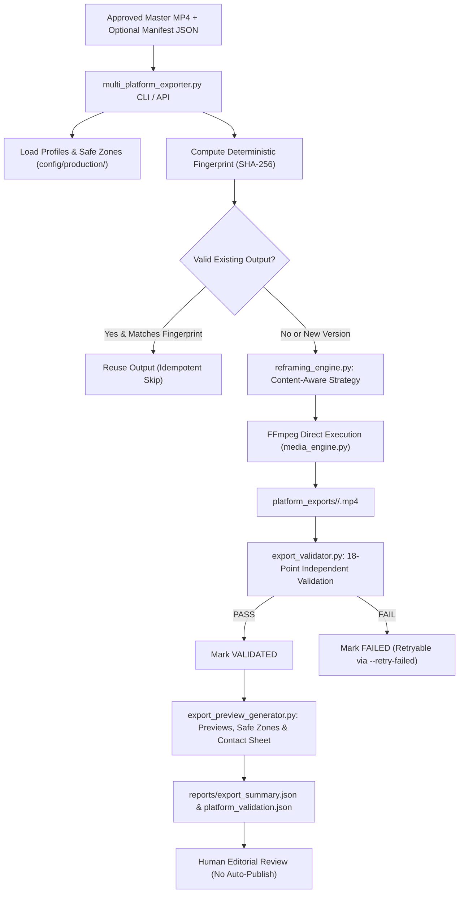

# Phase 4 Architecture: Multi-Platform Export & Adaptation Engine
**Studio:** Pyapiras Games  
**Workspace:** `C:\Users\Dell\Downloads\video gen\`  
**Document:** `docs/PHASE_4_ARCHITECTURE.md`  
**Date:** 2026-11-18  
**Phase Boundary:** Phase 4 Active — Phase 5 (QC Automation) Remains PLANNED  

---

## 1. Pre-Implementation Audit Summary

Before designing Phase 4, the existing codebase, Git state, catalogs, and approved renders were audited directly:

- **Git State:** Branch `main`, latest commit `3c8c415` (`feat(BPB_DAY_04): revise Day 4 hook to central full-text badge, pass dual QC, and sync to Google Drive`), with Phase 3 production pipeline code staged in the working tree.
- **Existing `scripts/platform_adapter.py`:** Generates platform-specific captions and JSON metadata packages for `multiplatform-pack-01` (used by Phase 1 Test D). It does **not** perform video reframing, multi-profile transcoding, safe-zone visualization, idempotent export tracking, or independent technical validation. **Decision:** Preserve `scripts/platform_adapter.py` untouched for full Phase 1 backwards compatibility; build Phase 4's dedicated video export engine alongside it.
- **Existing FFmpeg Infrastructure (`scripts/media_engine.py`):** Resolves the full-featured static FFmpeg 9.0.2 binary (`imageio-ffmpeg`) supporting `scale`, `pad`, `crop`, `overlay`, `boxblur`, `gblur`, `eq`, `setsar`, `fps`, `blackdetect`, and `volumedetect`, paired with Remotion's direct `ffprobe.exe` binary. **Decision:** Reuse `get_ffmpeg_cmd()`, `get_ffprobe_cmd()`, and `inspect_media()` directly.
- **Existing Platform Presets (`config/platform_presets/` & `config/production/video_profiles.json`):** Contains base specifications for `instagram_reel`, `youtube_short`, `facebook_reel`, `software_tutorial_vertical`, `youtube_tutorial_longform`, and `product_demo_horizontal`. **Decision:** Preserve existing preset JSONs intact and introduce dedicated Phase 4 `config/production/export_profiles.json` and `config/production/safe_zones.json` for rich export parameters, provisional safe-zone polygons, and reframing defaults.
- **Pilot Asset Audit:**
  - **Pilot A (Block Puzzle Burst Day 04):** Verified approved master exists at `outputs/block-puzzle-burst/30-day-challenge/day-04-offline-proof/final/Day_04_Final_Revised_Center_Text.mp4` (1080×1920 @ 30fps, 15.02s, 3.07 MB, authentic gameplay + approved full wording `"No WiFi? No problem. / 100% Offline Gameplay"`), paired with `config/manifests/manifest_bpb_day04_revision.json`.
  - **Pilot B (Expand EziSales Tutorial):** Visual frame audit revealed that `source_assets/expand-ezisales/screen-recordings/` is currently empty; the existing Phase 3 test master (`outputs/expand-ezisales/quick-start-tutorials/ezisales-tut-01-order-booking-pipeline/final/software_tutorial_vertical.mp4`) uses placeholder mobile footage rather than authentic EziSales ERP screen recordings, and contains an unverified `"Booked in Under 30s"` headline. Pilot B will therefore run as a technical multi-platform verification test explicitly flagged as `TECHNICAL_TEST_ONLY` pending real ERP screen footage and claim verification.

---

## 2. Target Workflow & System Architecture



---

## 3. Component Breakdown

| Component | Path | Responsibility | Reuses |
|---|---|---|---|
| **Export Profiles Config** | `config/production/export_profiles.json` | Defines `instagram_reels`, `youtube_shorts`, `facebook_reels`, `youtube_standard` (codec, container, resolution, bitrate, audio, default reframing). | Aligns with `video_profiles.json` & `platform_presets/` |
| **Safe-Zone Config** | `config/production/safe_zones.json` | Defines provisional UI occlusion zones and safe content areas per platform for preview rendering and placement checks. | Independent config (updatable without code edits) |
| **Reframing Engine** | `scripts/reframing_engine.py` | Implements 6 strategies (`CENTER_CROP`, `SMART_CROP`, `FIT_WITH_BACKGROUND`, `BLURRED_BACKGROUND`, `CUSTOM_LAYOUT`, `MANUAL_FOCAL_POINT`), content-aware recommendation, and manual-review flagging. | `media_engine.py`, `PIL` |
| **Export Validator** | `scripts/export_validator.py` | Independently runs 18 technical checks per export (FFprobe, full decode, SAR, A/V sync, black frames, audio clipping, truncation, safe-zone checks). | `media_engine.py`, `render_validator.py` |
| **Preview Generator** | `scripts/export_preview_generator.py` | Generates per-platform preview stills, safe-zone overlay visualizations, reframing comparisons, and multi-platform contact sheets. | `media_engine.py`, `PIL` |
| **Multi-Platform Exporter** | `scripts/multi_platform_exporter.py` | Orchestrates single, multi, selected-profile, and batch exports with fingerprinting, idempotency, safe overwrite protection, bounded parallelism, logging, and `--retry-failed`. | All Phase 4 modules + `media_engine.py` |

---

## 4. Reframing Strategy Selection Matrix

| Master Ratio → Target Ratio | Project / Content Type | Recommended Default Strategy | Rationale |
|---|---|---|---|
| **9:16 → 9:16** | All projects | `FIT_WITH_BACKGROUND` (1:1 aspect match) | Preserves 100% of original framing, overlays, and safe zones with zero cropping or stretching. |
| **9:16 → 16:9** (`youtube_standard`) | `block-puzzle-burst` (gameplay) | `BLURRED_BACKGROUND` | Preserves 100% of the vertical 10×10 board, score header, and bottom piece tray while filling side pillars with a darkened, softly blurred ambient canvas (zero hard black bars, zero cropped gameplay). |
| **9:16 → 16:9** (`youtube_standard`) | ERP tutorials (`expand-ezisales`, `expand-hr`, `wms`, `pos`) | `FIT_WITH_BACKGROUND` | Keeps small software UI controls and text crisp against a clean corporate dark backdrop without distracting background motion. |
| **16:9 → 9:16** | Gameplay / ERP | `BLURRED_BACKGROUND` or `SMART_CROP` (manual review flagged) | Prevents cutting off wide ERP forms or gameplay HUD unless focal point is explicitly verified. |

---

## 5. Idempotency, Output Protection & Retry Design

1. **Content/Profile Fingerprint:**
   `fingerprint = sha256(master_sha256 + profile_id + profile_spec_json + reframe_strategy + focal_point + manifest_sha256)[:16]`
2. **Reuse Rule:** If the target export exists, its recorded fingerprint matches, and it passes technical validation, the exporter skips re-encoding (`status: REUSED_VALID`).
3. **Overwrite Protection:** If a file exists at the target path with a different fingerprint (or without a matching metadata record) and `--force` is not explicitly set, the exporter **never overwrites** it; instead it writes a versioned artifact (`<stem>_v2.mp4`, `<stem>_v3.mp4`, ...).
4. **Failure Isolation & Retry:** Each profile executes independently and writes its own log (`reports/export_logs/<profile>.log`). If one profile fails, already-validated profiles remain untouched. Running `--job-id <id> --retry-failed` re-runs only failed profiles.
5. **Bounded Parallelism:** Defaults to sequential (`--max-workers 1`) and caps configurable concurrency at `2` workers to prevent saturating CPU/memory during simultaneous H.264 encodes.

---

## 6. Output Directory Convention

All Phase 4 outputs are written into an isolated export pack directory without moving or modifying original approved Phase 1–3 renders:

```text
outputs/<project>/<campaign>/<content_id>/
├── master/
│   ├── master_reference.json       # Source path, SHA-256, technical metadata
│   └── production_manifest.json    # Copy of source manifest (if provided)
├── platform_exports/
│   ├── instagram_reels/
│   │   └── <content_id>_instagram_reels.mp4
│   ├── youtube_shorts/
│   │   └── <content_id>_youtube_shorts.mp4
│   ├── facebook_reels/
│   │   └── <content_id>_facebook_reels.mp4
│   └── youtube_standard/
│       └── <content_id>_youtube_standard.mp4
├── previews/
│   ├── <profile>_preview.png
│   ├── <profile>_safe_zone.png
│   ├── reframing_comparison_9x16_vs_16x9.png
│   └── multi_platform_contact_sheet.png
└── reports/
    ├── export_summary.json
    ├── platform_validation.json
    ├── technical_comparison.json
    └── export_logs/
        └── <profile>_ffmpeg.log
```

---

## 7. Phase Boundaries & Preservation Rules

- **Phase 5 (QC Automation):** Not started. Phase 4 performs independent **technical** validation only and produces visual comparison sheets for **human** creative sign-off.
- **SolveItReel:** Left completely untouched as a separate outstanding task.
- **No Automatic Publishing:** Exports are staged locally for review only; no upload or social publishing is triggered automatically.
