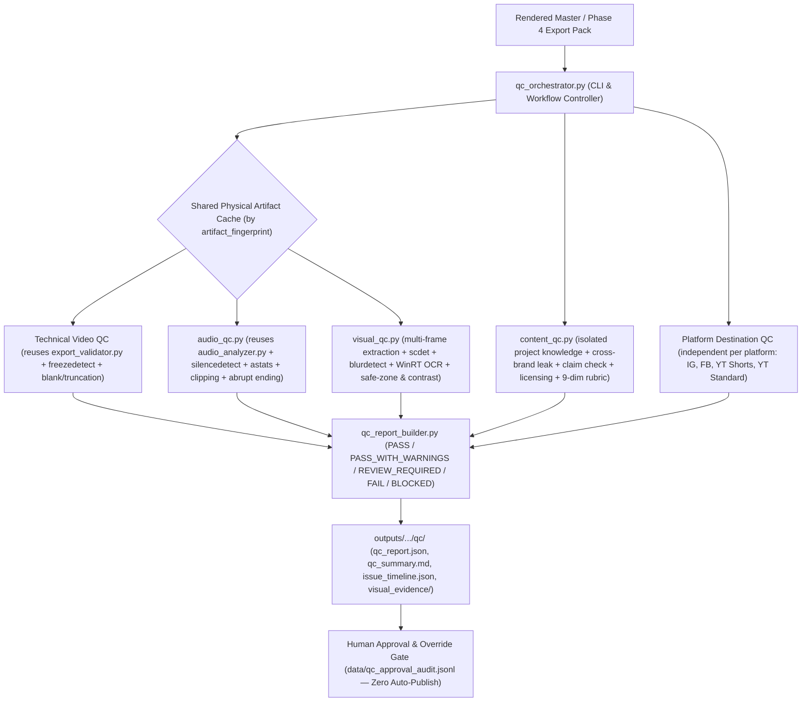

# Phase 5 Architecture: Automated Quality Control (QC) System
**Studio:** Pyapiras Games  
**Workspace:** `C:\Users\Dell\Downloads\video gen\`  
**Document:** `docs/PHASE_5_ARCHITECTURE.md`  
**Date:** 2026-11-18  
**Phase Boundary:** Phase 5 Active — Zero Auto-Publishing, Human Approval Mandatory  

---

## 1. Pre-Implementation Audit Findings

### A. Existing QC Infrastructure Audited
| Component | Current Role | Strengths | Identified Gaps Addressed in Phase 5 |
|---|---|---|---|
| `scripts/qc_verifier.py` | Phase 1 technical QC (7 checks) | Fast preset validation | No freeze-frame, black-frame, silence, clipping, visual, OCR, or licensing checks. |
| `scripts/render_validator.py` | Phase 3 post-render validator (6 checks) | Bitstream decode test | No acoustic loudness/silence/clipping or multi-frame visual inspection. |
| `scripts/export_validator.py` | Phase 4 18-point export validator | Strong FFprobe, full decode, `blackdetect`, `volumedetect`, SAR, A/V sync, platform duration bounds | Lacks freeze-frame detection, silence/gap detection, EBU R128 loudness check, multi-frame visual/OCR checks, content/knowledge/brand checks, and human override audit logs. |
| `scripts/creative_qc.py` | Phase 1 9-point creative rubric | Defines 9 studio marketing dimensions | **Critical audit finding:** Hardcodes static scores (`80/90`) regardless of actual video content. Preserved intact for Phase 1–3 regression compatibility; replaced in Phase 5 workflow with evidence-backed automated scoring + explicit `REVIEW_REQUIRED` for subjective dimensions. |
| `scripts/audio_analyzer.py` | Phase 2 acoustic & EBU R128 analyzer | Real EBU R128 loudness (`ebur128`), peak, waveform | Reused directly by Phase 5 `audio_qc.py`. |
| `scripts/campaign_manager.py` | SQLite campaign tracker | 8-stage editorial lifecycle & sign-off gate | Preserved untouched (`IDEA`..`PUBLISHED`); Phase 5 adds dedicated audit-logged QC job & human approval store (`data/qc_jobs/`, `data/qc_approval_audit.jsonl`). |

### B. Local Tool & Model Capability Audit (Factual Inventory)
Verified directly in the local Windows environment:
- **Deterministic Media & Signal Tools (AVAILABLE):** FFmpeg `9.0.2` (with `freezedetect`, `blackdetect`, `silencedetect`, `ebur128`, `volumedetect`, `astats`, `scdet`, `blurdetect`, `signalstats`), FFprobe, Python `PIL 13.0.0`, `NumPy 2.4.2`.
- **Local OCR Engine (AVAILABLE):** Windows built-in `Windows.Media.Ocr.OcrEngine` (`en-US`) invoked via `scripts/win_ocr.ps1`, returning extracted text lines and exact pixel bounding boxes (`x, y, width, height`) offline at zero cost. Verified live on Day 04 (`"No WiFi? No problem."`, `"100% Offline Gameplay"`).
- **Speech Recognition / ASR (NOT INSTALLED):** Neither `whisper`, `faster_whisper`, `speech_recognition`, nor Windows SAPI `SpeechRecognitionEngine` is installed locally. Voiceover transcript comparison is therefore explicitly marked `REVIEW_REQUIRED / PENDING_ASR` whenever voiceover text is present.
- **External Vision / Creative LLM APIs (NOT CONFIGURED):** No paid external LLM API is introduced. Subjective creative dimensions (emotional resonance, humour, storytelling quality) are explicitly flagged `REVIEW_REQUIRED` for human editorial review rather than faked by deterministic code.

### C. Phase 4 Closeout Reconciliation
- `tests/test_phase4_multi_platform_export.py` collects **24** actual `unittest` methods numbered `test_01`–`test_26` (`test_15` merged into `test_13`, `test_18` merged into `test_17`). Reconciled and recorded in `docs/PHASE_4_TEST_REPORT.md` (`24/24 PASS`, studio baseline `57/57 PASS`).

---

## 2. Phase 5 Modular Architecture

### Module Responsibilities
1. **`scripts/audio_qc.py`:** Integrated loudness (LUFS), true peak (dBTP), RMS/peak levels, clipping, excessive silence / audio gaps (`silencedetect`), abrupt ending detection, VO/music balance, expected SFX verification, and honest ASR status (`PENDING_ASR` → `REVIEW_REQUIRED`).
2. **`scripts/visual_qc.py`:** Multi-frame extraction across opening, per-scene midpoints, and closing; FFmpeg `freezedetect`, `blackdetect`, `scdet`, `blurdetect`; real WinRT OCR (`scripts/win_ocr.ps1`) with fuzzy match confidence; OCR bounding-box safe-zone & edge-truncation checks; local NumPy luminance contrast calculation; annotated visual defect evidence generation.
3. **`scripts/content_qc.py`:** Project-isolated knowledge loader (`projects/<project>/knowledge/`); cross-project branding/terminology leak detector; unsupported marketing claim detector (`VERIFICATION_REQUIRED`); Block Puzzle Burst English-only on-screen text check; catalog asset & SHA-256 + documentary licensing verification (`RESTRICTED`/`UNKNOWN` → `FAIL`, `NEEDS_REVIEW` → `REVIEW_REQUIRED`); evidence-backed 9-dimension creative rubric.
4. **`scripts/qc_report_builder.py`:** Unified QC Result Model (`PASS`, `PASS_WITH_WARNINGS`, `REVIEW_REQUIRED`, `FAIL`, `BLOCKED`), strict critical-failure override rule, `qc_report.json`, `qc_summary.md`, and `issue_timeline.json`.
5. **`scripts/qc_orchestrator.py`:** Runs single-master QC, shared-artifact multi-platform pack QC (analyzing physical artifacts once per unique `artifact_fingerprint` while validating each platform destination independently), job status inspection, report comparison, and audited human approval/override recording.
6. **`scripts/qc_calibration.py`:** Labeled clean + defective calibration & held-out validation runner measuring TP, FP, TN, FN, Precision, Recall, and Critical False-Pass Rate separately for deterministic vs. OCR checks.

---

## 3. Result Aggregation & Strict Gatekeeping Rules

| Overall Status | Rule | Blocks Progression? |
|---|---|---|
| `BLOCKED` | Required input video, manifest, or referenced source asset is missing/unreadable. | **YES** |
| `FAIL` | One or more `CRITICAL` checks failed (corrupt video, wrong profile, missing audio, clipping, freeze/black defect, cross-project branding leak, restricted/unknown audio license). **Overrides any high aggregate score.** | **YES** (until fixed or explicitly overridden with logged justification) |
| `REVIEW_REQUIRED` | Zero critical failures, but OCR confidence < threshold, unverified marketing claim (`VERIFICATION_REQUIRED`), `NEEDS_REVIEW` audio license, missing ASR, or subjective creative review pending. **Never silently promoted to `PASS`.** | **Requires explicit human sign-off** |
| `PASS_WITH_WARNINGS` | All automated checks passed; non-critical documented warnings exist. | **Requires human approval** |
| `PASS` | All applicable automated checks passed with zero warnings and zero pending review flags. | **Still requires human final publishing approval** |

---

## 4. Shared-Artifact QC Deduplication (Phase 4 Integration)

When evaluating a Phase 4 shared-artifact export pack (`outputs/<project>/<campaign>/<content_id>/`):
- Physical artifact checks (full decode, `blackdetect`, `freezedetect`, `silencedetect`, `ebur128`, multi-frame OCR, `blurdetect`) execute **once per unique `artifact_fingerprint`** (`VERTICAL_1080_1920`, `HORIZONTAL_1920_1080`).
- Platform-specific checks (duration limits, platform safe-zone overlay bounds against OCR boxes, delivery record integrity) execute **independently for every platform destination** (`instagram_reels`, `facebook_reels`, `youtube_shorts`, `youtube_standard`) and are stored separately in `qc/platform_results/<platform_id>_qc.json`.
