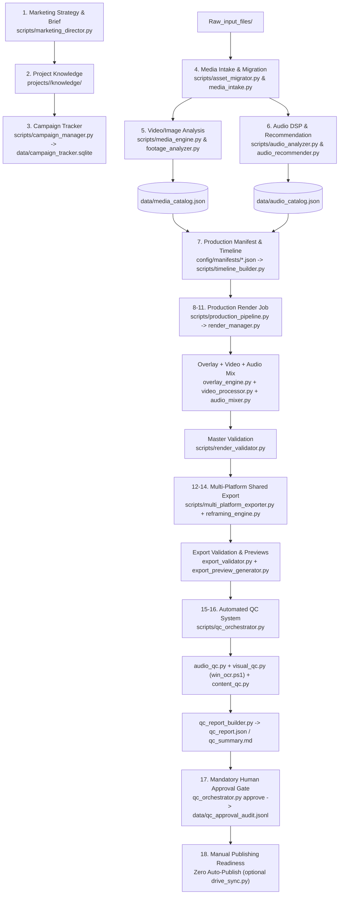
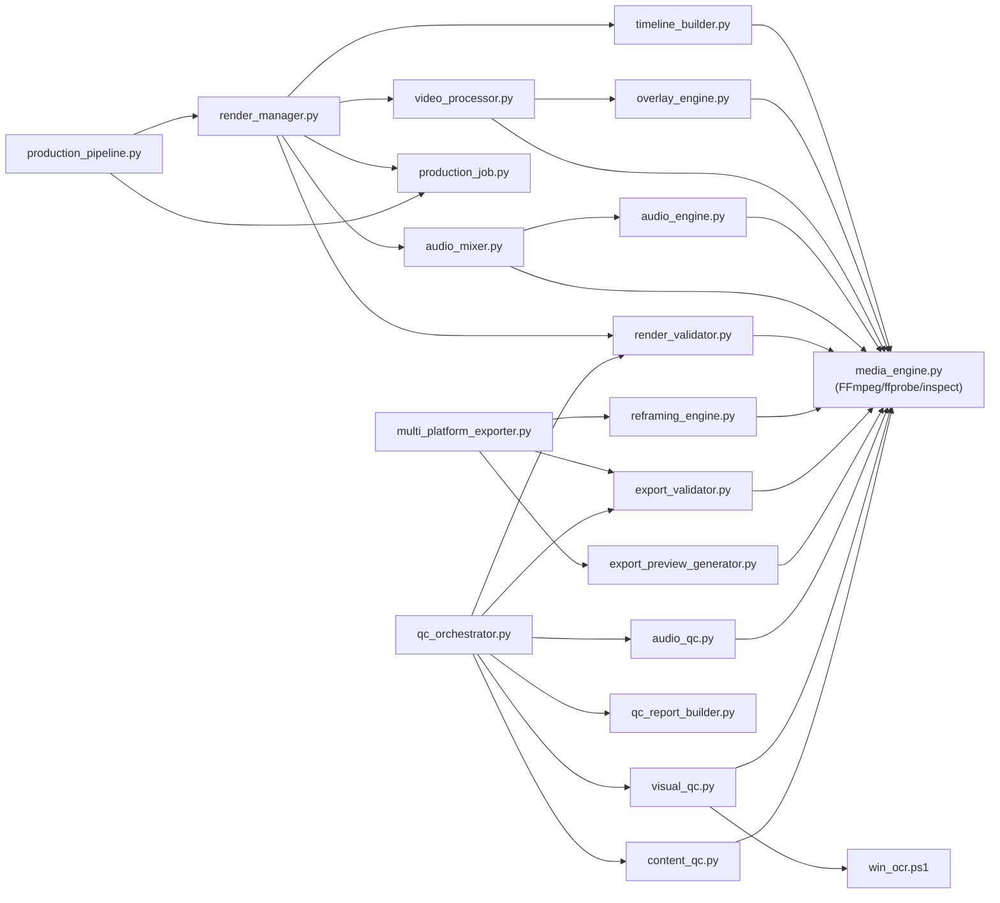

# 02 — Complete Architecture Audit

**Studio:** Social Media Video Production Studio  
**Audit Date:** 2026-11-18

---

## 1. End-to-End Studio Workflow Diagram

---

## 2. Module Dependency Architecture

**Circular Dependency Check:** **0 circular imports detected** across all 39 modules in `scripts/`. The layered dependency graph is cleanly acyclic (DAG).

---

## 3. Component-by-Component Architecture Trace (18 Workflow Stages)

| Stage | Primary Component(s) | Inputs | Outputs | State / DB Interaction | Failure & Recovery Behavior |
|---|---|---|---|---|---|
| 1. Strategy & Brief | `marketing_director.py` | Project slug, topic | `brief.md`, `script.md`, `manifest.json` | Registers item in SQLite via `campaign_manager.py` | Fails fast if project profile missing. |
| 2. Knowledge Repo | `projects/<project>/knowledge/` | Markdown ground-truth docs | Parsed corpus in `content_qc.py` | Read-only | Missing knowledge triggers `FAIL` in Phase 5 QC. |
| 3. Campaign Mgmt | `campaign_manager.py` | CLI / API calls | `data/campaign_tracker.sqlite` | SQLite `content_items` table | **Weakness (`AUD-002`):** `QC_APPROVED` gate & sequential transitions unenforced; `update_status()` bypasses publishing gate. |
| 4. Media Intake | `asset_migrator.py`, `media_intake.py` | `Raw_input_files/`, `source_assets/` | Copied assets, `migration_log.json`, `media_catalog.json` | Non-destructive copy + SHA-256 dedup | Safe against overwrite; non-atomic JSON writes (`AUD-014`). |
| 5. Video/Image Analysis | `media_engine.py`, `footage_analyzer.py` | Video/image paths | Codec, fps, dimensions, transparency, SHA-256 | Writes `media_catalog.json` | Handles corrupt files cleanly; missing subprocess timeouts (`AUD-013`). |
| 6. Audio Analysis & Rec | `audio_analyzer.py`, `audio_recommender.py` | Audio stems / MP3s | Loudness, BPM, energy, mood, license status | Writes `audio_catalog.json` | Commercial license gate enforces `VERIFIED_COMMERCIAL_USE` unless preview flag set. |
| 7. Manifest & Timeline | `timeline_builder.py` | `config/manifests/*.json` | Resolved scene timeline & audio plan | Reads `media_catalog.json` & `audio_catalog.json` | Fails preflight on missing asset, invalid trim bounds, or unlicensed audio. |
| 8–11. Production Render | `production_pipeline.py`, `render_manager.py`, `production_job.py`, `overlay_engine.py`, `video_processor.py`, `audio_mixer.py`, `audio_engine.py` | Resolved timeline | Master MP4, logs, `data/production_jobs/*.json` | Persists `ProductionJob` state (`PENDING`->`COMPLETED`/`FAILED`) | Preserves job failure log; **Bugs:** TTS PowerShell injection (`AUD-001`), FFmpeg `-t` placement (`AUD-009`), absolute path persistence (`AUD-005`). |
| 12–14. Multi-Platform Export & Shared Dedup | `multi_platform_exporter.py`, `reframing_engine.py`, `export_preview_generator.py`, `audit_export_duplicates.py` | Master MP4 + `export_profiles.json` + `render_profiles.json` | Physical artifacts (`artifacts/`), delivery records (`deliveries/`), previews, `data/export_jobs/*.json` | Content-addressed fingerprint caching; idempotent reuse | **Bug (`AUD-003`):** `#BlockPuzzle`/`#PyapirasGames` default hashtags leak from global profile into non-game delivery records. |
| 15. Technical Validation | `render_validator.py`, `export_validator.py` | Master or platform MP4 | 14-check technical validation JSON | Stateless | Full FFmpeg decode (`-f null -`) detects stream corruption. |
| 16. Automated QC | `qc_orchestrator.py`, `audio_qc.py`, `visual_qc.py`, `content_qc.py`, `qc_report_builder.py`, `win_ocr.ps1` | Master or export pack | `qc_report.json`, `issue_timeline.json`, `qc_summary.md`, `visual_evidence/`, `audio_evidence/`, `data/qc_jobs/*.json` | Shared-artifact scan caching by `artifact_fingerprint` | Critical-failure override blocks progression (`FAIL`/`BLOCKED`); offline ASR & subjective editorial honestly return `REVIEW_REQUIRED`. |
| 17. Human Approval | `qc_orchestrator.py approve` | `--job-id`, `--decision`, `--reviewer` | `data/qc_approval_audit.jsonl`, updated `data/qc_jobs/*.json` | Append-only audit trail (`auto_published: false`) | Rejects `APPROVE` on `FAIL`/`BLOCKED`; requires written override justification. **Gap:** Decoupled from `campaign_tracker.sqlite` (`AUD-002`). |
| 18. Delivery Readiness | Manual upload / `drive_sync.py` | Approved outputs | Optional copy to Google Drive local mount | None | **Risk (`AUD-004`):** `drive_sync.py` does not check QC approval and lacks path traversal validation. |

---

## 4. Key Architectural Strengths & Structural Fault Lines

### Strengths
- Zero circular dependencies across 39 Python modules.
- Clean separation of platform destination profile vs. physical rendering profile vs. physical artifact (Phase 4.1).
- Evidence-first Phase 5 QC architecture with real DSP + local WinRT OCR and honest capability boundaries (zero fake ASR or fake subjective PASS).
- Strict zero-auto-publishing enforcement in both Phase 1 (`campaign_manager.py` via `advance_state`) and Phase 5 (`qc_orchestrator.py`).

### Structural Fault Lines
1. **Two Disconnected State Stores:** Phase 1 `data/campaign_tracker.sqlite` and Phase 3–5 JSON stores (`data/production_jobs/`, `data/export_jobs/`, `data/qc_jobs/`, `data/qc_approval_audit.jsonl`) do not synchronize state transitions. Approving a QC job in Phase 5 does not update `campaign_tracker.sqlite`, and `campaign_manager.py` still checks legacy `creative_qc_score >= 72`.
2. **Legacy + Modern Coexistence (`AUD-012`):** Four config files define overlapping video/platform specs with inconsistent singular/plural IDs (`instagram_reel` vs `instagram_reels`).
3. **Host-Specific Absolute Path Persistence (`AUD-005`):** Job JSONs and SQLite store absolute Windows paths, impeding portability and root folder renaming.
