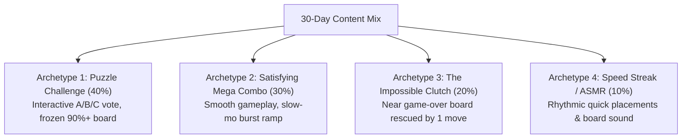

# 30-Day AI Block Puzzle Reels Master Plan

## 1. Project Overview & Strategy
* **Game:** Block Puzzle Burst
* **Platform:** Instagram Reels (9:16 Vertical, 1080×1920, 30fps)
* **Goal:** Publish 1 high-retention, high-engagement Reel daily for 30 consecutive days to drive game downloads and organic community engagement.
* **Core Philosophy:**
  * Preserve authentic gameplay without synthetic AI gameplay generation.
  * 100% local rendering using Remotion React engine with zero recurring API costs.
  * Every Reel is optimized for watch time, loopability, and comment-section triggers (e.g., voting A/B/C).

---

## 2. Four Core Reel Archetypes

To prevent audience fatigue and maximize algorithmic reach, the 30 days rotate across four proven formats:



### Archetype 1: Interactive Puzzle Challenge (Days 3, 7, 10, 14, 17, 21, 24, 28)
* **Hook:** "Solve it in ONE move" / "Can you spot the winning piece?"
* **Mechanics:**
  * Board is 90%+ filled.
  * Video freezes for 8–10s while badges **A**, **B**, and **C** appear over bottom pieces.
  * 5-dot countdown bar counts down.
  * Answer reveals and video unfreezes showing the combo clear.
* **Comment Trigger:** "Comment A, B or C below 👇"

### Archetype 2: Satisfying Mega Combo Burst (Days 1, 2, 6, 9, 13, 16, 20, 23, 27, 30)
* **Hook:** "Wait for the last piece" / "The most satisfying clear today"
* **Mechanics:**
  * Continuous uninterrupted gameplay at normal 1.0× speed.
  * Speed drops to 0.3× slow-mo right as the winning piece connects.
  * Spring-driven glowing pulse on the score / combo banner (`#FFD700`).
* **Comment Trigger:** "How big is your best combo? 🔥"

### Archetype 3: The Clutch / Near-Death Save (Days 4, 8, 12, 15, 19, 22, 26, 29)
* **Hook:** "I thought this run was over..." / "Only 1% see the safe spot"
* **Mechanics:**
  * Board has only 2–3 open squares left.
  * Subtle camera zoom-in (`scale: 1.15`) toward the critical slot.
  * Dramatic placement clearing 4+ lines simultaneously.
* **Comment Trigger:** "Would you have survived this? 💀"

### Archetype 4: High-Speed Streak Challenge (Days 5, 11, 18, 25)
* **Hook:** "Speed run: 5 combos in 10 seconds"
* **Mechanics:**
  * Fast-paced 1.25× speed gameplay.
  * On-screen combo counter ticking upward with spring bounces.
* **Comment Trigger:** "What's your highest streak record?"

---

## 3. Complete 30-Day Publishing Calendar

| Day | Archetype | Opening Hook Copy | Visual Mechanics | Call-To-Action (Outro) |
| :---: | :--- | :--- | :--- | :--- |
| **01** | Satisfying Combo | "Wait for the quad clear..." | Normal speed into 0.3× slow-mo on 4-line burst | "Rate this clear 1-10 ✨" |
| **02** | Satisfying Combo | "Wait for the last piece" | 1.0× into 0.3× slow-mo combo pulse (`MyDayTwoReel.tsx`) | "How big is your best combo? 🔥" |
| **03** | Puzzle Challenge | "Solve it in ONE move" | Freeze at frame 1780 (93% full), Badges A/B/C (`MyDayThreeReel.tsx`) | "Comment A, B or C below 👇" |
| **04** | Clutch Save | "I thought this run was dead..." | Red vignette pulse, zoom 1.15× onto tight slot | "Did you think I'd make it? 😅" |
| **05** | Speed Streak | "Can we hit a 6x Combo?" | 1.2× speed ramp, combo multiplier popups | "Beat this score in Block Puzzle Burst!" |
| **06** | Satisfying Combo | "The cleanest line clear today" | Centered hook pill, slow-mo explosion ripple | "Link in bio to play free 📲" |
| **07** | Puzzle Challenge | "Which piece saves the board?" | Frozen 90% full board, 3 candidate trays | "A, B or C? Answer in 5s! ⏱️" |
| **08** | Clutch Save | "One wrong move and it's over" | Subtle heartbeat zoom, tension sound | "Drop a 🧠 if you saw the move" |
| **09** | Satisfying Combo | "Don't blink at 0:08..." | Speed ramp on line clear, gold particle glow | "Comment your highest score 🏆" |
| **10** | Puzzle Challenge | "Level 99 IQ Test 🧩" | 3 pieces in tray, A/B/C spring badges, reveal | "Did you pick right? Comment below 👇" |
| **11** | Speed Streak | "Rapid Fire Clear Mode" | Fast cuts across 3 consecutive combo moves | "Can your fingers move this fast?" |
| **12** | Clutch Save | "Literally 1 square left" | Focus box on single open slot, clutch drop | "Panic mode activated 😱" |
| **13** | Satisfying Combo | "The golden block placement" | Gold color grade on burst, 0.3× slow-motion | "So satisfying to watch on loop 🔁" |
| **14** | Puzzle Challenge | "Only true gamers spot B" | A/B/C badges, thinking countdown timer | "Did you choose B or get tricked? 😂" |
| **15** | Clutch Save | "Saved with 0.1s to spare" | Slow zoom-in on board corner, line sweep | "Share with a friend who always loses" |
| **16** | Satisfying Combo | "Satisfying sound on 🎧" | Original popping sound effect highlighted | "Turn volume UP for this clear 🔊" |
| **17** | Puzzle Challenge | "Which piece clears 3 lines?" | Freeze at board lock, target solution box | "Drop your guess: A, B or C 👇" |
| **18** | Speed Streak | "10 Second Speedrun" | Time ticker overlay, fast combo chain | "Try beating this streak!" |
| **19** | Clutch Save | "Board was 98% full..." | Deep dark neon overlay, triple line burst | "Could you pull this off?" |
| **20** | Satisfying Combo | "Wait for the board reset..." | Full grid wipe animation, gold burst flash | "Best feeling in the game 💥" |
| **21** | Puzzle Challenge | "Brain teaser: Move 1 of 3" | 5-dot countdown bar, answer highlight | "Who got it before the timer? ⏱️" |
| **22** | Clutch Save | "The luckiest piece drop ever" | Freeze on danger board, clutch placement | "Skill or pure luck? You decide 🤔" |
| **23** | Satisfying Combo | "When the 3x3 block fits perfectly" | Square block drop, satisfying board shockwave | "Drop a 🔥 if you love block puzzles" |
| **24** | Puzzle Challenge | "Spot the trap piece ⚠️" | A/B/C badges with 1 trap candidate | "Did you fall for the trap? 💀" |
| **25** | Speed Streak | "Combo streak record 🚀" | On-screen streak counter 1x -> 7x | "Can anyone top this streak?" |
| **26** | Clutch Save | "No way this cleared..." | Zoom on 2-row clear from bottom piece | "Mind = blown 🤯" |
| **27** | Satisfying Combo | "Smooth neon block burst" | Purple & Gold neon particle glow | "Play Block Puzzle Burst free today!" |
| **28** | Puzzle Challenge | "The Ultimate Puzzle Challenge" | Hardest grid state, 5s think countdown | "Comment your answer before reveal!" |
| **29** | Clutch Save | "Surviving against all odds" | Dramatic pause before placement | "Drop your reaction in comments 👇" |
| **30** | Satisfying Combo | "Day 30 Grand Finale Clear" | Massive multi-line combo, victory celebration | "Thank you for 30 days! Download now 📲" |

---

## 4. Automation & Batch Rendering Pipeline

Each composition accepts parameterized props via CLI or Python script:

```bash
# Day 02 Render:
npx remotion render MyDayTwoReel Generated_Outputs/videos/Day_02.mp4

# Day 03 Render:
npx remotion render MyDayThreeReel Generated_Outputs/videos/Day_03.mp4 --props='{
  "config": {
    "pauseAtVideoFrame": 1780,
    "correctAnswer": "B",
    "hookLanguage": "EN"
  }
}'
```
