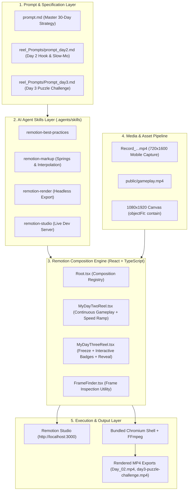
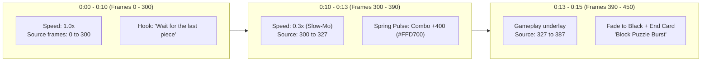
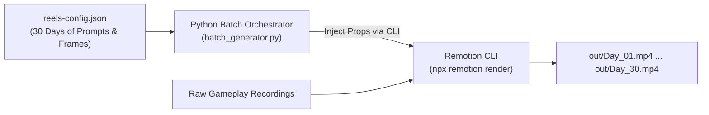

# Project Architecture: 30-Day AI Block Puzzle Reels Generator

This document provides a comprehensive technical breakdown of the architecture powering the **30-Day AI Block Puzzle Reels Generator**. The system combines natural language prompt specifications, Remotion's React-based deterministic video rendering engine, and local headless video processing to produce 1080×1920 Instagram Reels without third-party paid video-generation APIs.

---

## 1. High-Level System Architecture



---

## 2. Layered Architecture Breakdown

### Layer 1: Specification & Creative Prompt Layer
* **Location:** [`prompt.md`](file:///c:/Users/Dell/Downloads/video%20gen/prompt.md), [`reel_Prompts/`](file:///c:/Users/Dell/Downloads/video%20gen/reel_Prompts)
* **Purpose:** Defines the creative concept, visual identity, hook copy, timeline events, and call-to-action for each day's Reel.
* **Separation of Concerns:** Creative parameters (hook text, language, freeze frames, badge coordinates) are isolated in a declarative `CONFIG` structure so non-developers or automation scripts can adjust video behavior without rewriting animation code.

### Layer 2: Agent Skills & Knowledge Layer
* **Location:** [`.agents/skills/`](file:///c:/Users/Dell/Downloads/video%20gen/.agents/skills)
* **Standard:** Universal Agent Skills specification (`skills.sh`).
* **Installed Modules:**
  * `remotion-markup`: Enforces frame-driven animations using `interpolate()` and `spring()` instead of CSS transitions which fail in headless renderers.
  * `remotion-render`: Provides optimal CLI and programmatic render configurations (concurrency, codecs, headless Chromium arguments).
  * `remotion-studio`: Configures interactive real-time browser previewing.
  * `remotion-captions`: Handles subtitle rendering and timing sync.

### Layer 3: Remotion React Video Engine
* **Location:** [`my-video/src/`](file:///c:/Users/Dell/Downloads/video%20gen/my-video/src)
* **Architecture:** Component-driven composition hierarchy. Remotion treats video frames as discrete, deterministic React renders:
  $$\text{Render}(frame) = f(\text{props}, frame)$$
* **Core Components:**
  * [`Root.tsx`](file:///c:/Users/Dell/Downloads/video%20gen/my-video/src/Root.tsx): Central entry point declaring compositions (`<Composition />`) with dimensions, frame rate (30 fps), duration (450 frames = 15s), and default props.
  * [`MyDayTwoReel.tsx`](file:///c:/Users/Dell/Downloads/video%20gen/my-video/src/MyDayTwoReel.tsx): Multi-speed continuous gameplay pipeline.
  * [`MyDayThreeReel.tsx`](file:///c:/Users/Dell/Downloads/video%20gen/my-video/src/MyDayThreeReel.tsx): Interactive puzzle challenge with video freeze, countdown timer, and reveal.
  * [`FrameFinder.tsx`](file:///c:/Users/Dell/Downloads/video%20gen/my-video/src/FrameFinder.tsx): Development composition for scrubbing video frames and verifying board coordinates.

### Layer 4: Media Coordinate & Aspect Ratio Pipeline
* **Source Capture:** Mobile screen recording (`720 × 1600`, aspect ratio $9:20 = 0.45$).
* **Canvas Output:** Standard Instagram Reel (`1080 × 1920`, aspect ratio $9:16 = 0.5625$).
* **Fitting Strategy:**
  * `objectFit: "contain"` scales the 720×1600 video by $1.2\times$, resulting in an $864 \times 1920\text{px}$ footprint centered horizontally on the $1080\text{px}$ canvas.
  * **Result:** 100% of the game board, scores, and bottom candidate piece tray remain completely visible without being cropped. The side letterboxing is filled with the theme background color `#0D0D0D`.

---

## 3. Timeline & State Engine Architecture

### Day 2: Continuous Variable-Speed Pipeline
To achieve continuous gameplay across varying playback rates without audio desync or visible cuts, the timeline is partitioned into sequential mathematical offsets:



$$\text{SourceFrame}(t) = \begin{cases} 
t & 0 \le t < 300 \\
300 + (t - 300) \times 0.3 & 300 \le t < 390 \\
327 + (t - 390) \times 1.0 & 390 \le t \le 450 
\end{cases}$$

---

### Day 3: Freeze, Think & Reveal Pipeline
Day 3 implements a puzzle challenge with video freeze state, synchronized overlay timers, and answer unfreezing:

```mermaid
sequenceDiagram
    autonumber
    actor Viewer
    participant Composition as MyDayThreeReel (450 frames)
    participant Video as OffthreadVideo (gameplay.mp4)
    participant Overlays as Badges (A, B, C) & Countdown

    Note over Composition,Video: 0:00 - 0:01.5 (Frames 0 - 45)
    Composition->>Video: Play frames 1735 -> 1780 (93.2% full board)
    Composition->>Overlays: Display Top Hook Banner ("Solve it in ONE move")

    Note over Composition,Video: 0:01.5 - 0:06.5 (Frames 45 - 195)
    Composition->>Video: Freeze at Frame 1780
    Composition->>Overlays: Staggered spring entrance for Badges A, B, C

    Note over Composition,Video: 0:06.5 - 0:11.5 (Frames 195 - 345)
    Composition->>Overlays: Thinking Countdown (5 gold dots, 1 active per 30 frames)
    Composition->>Overlays: Pulsing text: "Where does the piece go?"

    Note over Composition,Video: 0:11.5 - 0:14.0 (Frames 345 - 420)
    Composition->>Overlays: Correct Badge (B) scales to 1.5x with gold glow; A & C dim to 0.35
    Composition->>Overlays: Highlight Solution Box on grid (x: 390, y: 690)
    Composition->>Video: Unfreeze from Frame 1780 (Viewer sees piece placed & lines clear!)

    Note over Composition,Video: 0:14.0 - 0:15.0 (Frames 420 - 450)
    Composition->>Overlays: Outro Card ("Comment A, B or C below 👇")
```

---

## 4. Design System & Theming Tokens

| Token | Value | Role |
| :--- | :--- | :--- |
| **Canvas Background** | `#0D0D0D` | Deep black foundation matching mobile OLED displays |
| **Brand Accent** | `#7B2FBE` | Electric purple used for pill containers, badge fills, and ambient glows |
| **Highlight & Gold** | `#FFD700` | High-contrast gold used for combo scores, winning badges, and countdown indicators |
| **Text Primary** | `#FFFFFF` | Bold headings with drop shadows for legibility over active gameplay |
| **Typography** | `'Poppins', 'Inter', sans-serif` | Clean, modern geometric sans-serif |
| **Motion Physics** | `damping: 12, stiffness: 160` | Snappy, organic spring animations without mechanical easing artifacts |

---

## 5. Scaling to 30-Day Batch Automation

To fulfill the automation goal outlined in [`prompt.md`](file:///c:/Users/Dell/Downloads/video%20gen/prompt.md), the architecture supports a headless batch runner:



### Parameterized Props Schema
Every composition accepts typed props that can be overridden at render time without recompilation:
```bash
npx remotion render MyDayThreeReel out/Day_04.mp4 --props='{
  "config": {
    "pauseAtVideoFrame": 2400,
    "correctAnswer": "A",
    "hookLanguage": "EN"
  }
}'
```

This allows a simple Python script or local web interface to generate all 30 days of distinct content automatically.
